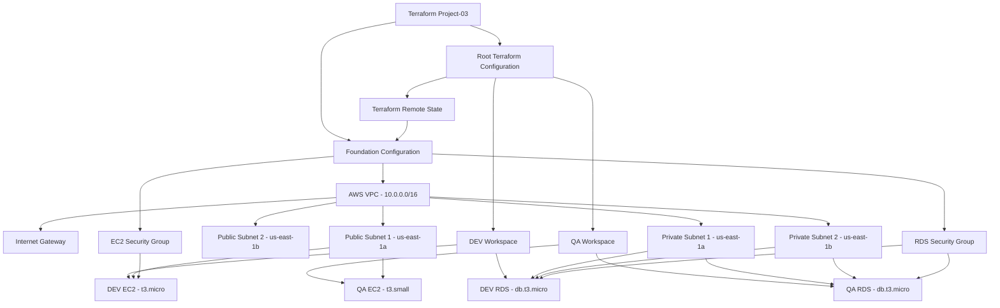

# Project-03: Terraform Modules with Multiple Workspaces (AWS)

## 1. Project Overview

This project demonstrates how to provision and manage AWS infrastructure using **Terraform modules, multiple workspaces, and remote state data sharing**.

The objective is to build reusable Terraform modules and deploy separate DEV and QA environments while sharing a common networking foundation.

The project follows Infrastructure as Code (IaC) principles and demonstrates how infrastructure teams can organize, reuse, provision, and manage cloud resources consistently across multiple environments.

### Key objectives

- Provision AWS networking infrastructure using Terraform.
- Create reusable EC2 and RDS modules.
- Implement DEV and QA environments using Terraform workspaces.
- Share networking outputs between separate Terraform configurations using `terraform_remote_state`.
- Use environment-specific infrastructure configurations.
- Manage infrastructure through Terraform plan, apply, and destroy.
- Protect sensitive configuration values using Terraform variables and `.gitignore`.
- Maintain project code in GitHub using a feature branch.

---

## 2. Technologies Used

| Technology | Purpose |
|---|---|
| AWS | Cloud infrastructure |
| Terraform | Infrastructure as Code |
| AWS VPC | Network isolation |
| EC2 | Application server |
| Amazon RDS | Managed PostgreSQL database |
| Terraform Modules | Reusable infrastructure components |
| Terraform Workspaces | Environment separation |
| Terraform Remote State | Sharing infrastructure outputs |
| Git | Version control |
| GitHub | Source code repository |
| Git Bash | Command-line operations |

**AWS Region:** `us-east-1`

---

## 3. Architecture Diagram

The architecture consists of a shared networking foundation and two independent application environments.



### Architecture explanation

1. The foundation configuration creates the shared VPC and networking components.
2. Public subnets are used for EC2 instances.
3. Private subnets are used for RDS databases.
4. The EC2 security group allows SSH traffic from the configured trusted IP address.
5. The RDS security group allows PostgreSQL traffic on port 5432 from the EC2 security group.
6. The root Terraform configuration reads networking outputs from the foundation state.
7. The DEV and QA workspaces provision independent EC2 and RDS resources.
8. Reusable modules avoid duplicating EC2 and RDS resource definitions.

**Important:** The foundation and root configurations maintain separate Terraform state files. Destroy application environments before destroying the shared foundation.

---

## 4. Project Directory Structure

```text
project-03/
│
├── .gitignore
├── .terraform.lock.hcl
│
├── foundation/
│   ├── .terraform.lock.hcl
│   ├── networking.tf
│   ├── outputs.tf
│   ├── providers.tf
│   └── variables.tf
│
├── main.tf
├── outputs.tf
├── providers.tf
├── variables.tf
│
└── modules/
    ├── ec2/
    │   ├── main.tf
    │   ├── outputs.tf
    │   └── variables.tf
    │
    └── rds/
        ├── main.tf
        ├── outputs.tf
        └── variables.tf
```

### File responsibilities

| File / Directory | Responsibility |
|---|---|
| `foundation/` | Creates shared networking infrastructure |
| `foundation/networking.tf` | Defines VPC, subnets, route tables, IGW and security groups |
| `foundation/variables.tf` | Defines foundation input variables |
| `foundation/outputs.tf` | Exposes networking resource IDs |
| `providers.tf` | Configures AWS provider |
| `main.tf` | Reads foundation state and calls modules |
| `variables.tf` | Defines root configuration variables |
| `outputs.tf` | Exposes EC2 and RDS outputs |
| `modules/ec2/` | Reusable EC2 module |
| `modules/rds/` | Reusable RDS module |
| `.gitignore` | Prevents state files and sensitive configuration from being committed |

---

## 5. Infrastructure Components

### 5.1 Networking Foundation

The foundation configuration provisions the shared network infrastructure.

| Resource | Configuration |
|---|---|
| VPC | `10.0.0.0/16` |
| Availability Zones | `us-east-1a`, `us-east-1b` |
| Public subnet 1 | `10.0.1.0/24` |
| Public subnet 2 | `10.0.2.0/24` |
| Private subnet 1 | `10.0.3.0/24` |
| Private subnet 2 | `10.0.4.0/24` |
| Internet Gateway | Attached to VPC |
| Public Route Table | Default route through IGW |
| EC2 Security Group | SSH access from trusted IP |
| RDS Security Group | PostgreSQL access from EC2 security group |

### 5.2 EC2 Module

The EC2 module provisions application servers.

| Environment | Instance Type |
|---|---|
| DEV | `t3.micro` |
| QA | `t3.small` |

The module accepts the following inputs:

- AMI ID
- Instance type
- Subnet ID
- Security group IDs
- Project name
- Environment name

The module exports:

- EC2 instance ID
- Public IP
- Private IP

### 5.3 RDS Module

The RDS module provisions managed PostgreSQL databases.

| Configuration | Value |
|---|---|
| Engine | PostgreSQL |
| Engine Version | 16.15 |
| Instance Class | `db.t3.micro` |
| Allocated Storage | 20 GB |
| Database Name | Configured through variable |
| Public Accessibility | Disabled |
| Storage Encryption | Enabled |
| Backup Retention | 1 day |
| Port | 5432 |

Each environment receives its own database instance.

The RDS module accepts database credentials through variables. The database password is marked sensitive and stored in a local, ignored `terraform.tfvars` file.

**Security note:** Marking a Terraform variable as sensitive hides its value in normal CLI output, but does not encrypt it in the Terraform state file. Protect state access and avoid committing credentials.

---

## 6. Terraform Modules

This project uses reusable modules to separate resource definitions from environment-specific configuration.

### Why modules?

Without modules, EC2 and RDS resource definitions would need to be duplicated for DEV and QA.

With modules, we define the infrastructure once and pass different inputs for each environment.

Example:

```hcl
module "ec2" {
  source = "./modules/ec2"

  project_name       = var.project_name
  environment        = local.environment
  ami_id             = var.ami_id
  instance_type      = local.instance_types[local.environment]
  subnet_id          = data.terraform_remote_state.networking.outputs.public_subnet_ids[0]
  security_group_ids = [
    data.terraform_remote_state.networking.outputs.ec2_security_group_id
  ]
}
```

The same module is reused in DEV and QA. The workspace determines the environment-specific instance type and resource tags.

---

## 7. Terraform Workspaces

Terraform workspaces allow the same root configuration to maintain separate state files for different environments.

This project uses:

- `dev`
- `qa`

The built-in `default` workspace also exists, but it is not used for application deployment.

### Workspace commands

List workspaces:

```bash
terraform workspace list
```

Create DEV workspace:

```bash
terraform workspace new dev
```

Select DEV:

```bash
terraform workspace select dev
```

Check the current workspace:

```bash
terraform workspace show
```

Create QA workspace:

```bash
terraform workspace new qa
```

Select QA:

```bash
terraform workspace select qa
```

### Environment-specific configuration

The root configuration uses the current workspace:

```hcl
locals {
  environment = terraform.workspace

  instance_types = {
    dev = "t3.micro"
    qa  = "t3.small"
  }

  db_instance_classes = {
    dev = "db.t3.micro"
    qa  = "db.t3.micro"
  }
}
```

This allows Terraform to provision different configurations without maintaining separate copies of the root configuration.

**Important:** Workspaces separate Terraform state, but they do not provide complete security or environment isolation. For larger production environments, separate accounts, permissions, and state backends may be more appropriate.

---

## 8. Terraform Remote State

The foundation configuration and root configuration use separate state files.

The root configuration reads networking outputs from the foundation state using `terraform_remote_state`.

Example:

```hcl
data "terraform_remote_state" "networking" {
  backend = "local"

  config = {
    path = "${path.module}/foundation/terraform.tfstate"
  }
}
```

The root configuration accesses outputs such as:

```hcl
data.terraform_remote_state.networking.outputs.vpc_id

data.terraform_remote_state.networking.outputs.public_subnet_ids

data.terraform_remote_state.networking.outputs.private_subnet_ids

data.terraform_remote_state.networking.outputs.ec2_security_group_id

data.terraform_remote_state.networking.outputs.rds_security_group_id
```

### Why use remote state?

- Avoid hardcoding resource IDs.
- Share outputs between independent Terraform configurations.
- Keep foundation infrastructure separate from application infrastructure.
- Make resource dependencies easier to manage.

**Note:** Despite the Terraform data source name, this project uses the `local` backend for the foundation state file. It is not stored in an S3 remote backend. For a team or production environment, consider a secured S3 backend with state locking.

---

## 9. Deployment Procedure

Run the following commands from the `project-03` directory unless specified otherwise.

### Step 1: Initialize foundation

```bash
cd foundation
terraform init
```

### Step 2: Validate foundation

```bash
terraform fmt -recursive
terraform validate
terraform plan
```

### Step 3: Deploy foundation

```bash
terraform apply
```

Review the plan and confirm the operation.

### Step 4: Return to the root directory

```bash
cd ..
```

### Step 5: Initialize root configuration

```bash
terraform init
```

### Step 6: Validate root configuration

```bash
terraform fmt -recursive
terraform validate
```

### Step 7: Deploy DEV

```bash
terraform workspace new dev
terraform plan
terraform apply
```

If the DEV workspace already exists, use:

```bash
terraform workspace select dev
```

### Step 8: Deploy QA

```bash
terraform workspace new qa
terraform plan
terraform apply
```

If the QA workspace already exists, use:

```bash
terraform workspace select qa
```

### Step 9: Verify resources

```bash
terraform workspace list
terraform workspace show
terraform state list
terraform output
```

Remember to select the correct workspace before running state and output commands.

---

## 10. Important Terraform Commands

| Command | Purpose |
|---|---|
| `terraform init` | Initializes the working directory and downloads providers |
| `terraform fmt` | Formats Terraform files |
| `terraform validate` | Checks configuration syntax and consistency |
| `terraform plan` | Previews infrastructure changes |
| `terraform apply` | Creates or updates infrastructure |
| `terraform destroy` | Deletes resources managed by the current state |
| `terraform workspace list` | Lists available workspaces |
| `terraform workspace new dev` | Creates a workspace |
| `terraform workspace select dev` | Switches workspace |
| `terraform workspace show` | Displays current workspace |
| `terraform state list` | Lists resources tracked in the state |
| `terraform output` | Displays output values |
| `terraform providers` | Displays required providers |
| `terraform graph` | Generates a dependency graph |
| `terraform show` | Displays the current state or plan |

---

## 11. Actual Deployment Results

The following are the results observed during the lab deployment.

### DEV environment

| Resource | Result |
|---|---|
| EC2 Instance | `i-02a438b56a7a6c3c1` |
| EC2 Type | `t3.micro` |
| Private IP | `10.0.1.85` |
| Public IP | `44.199.193.14` |
| RDS Identifier | `terraform-lab-dev-db` |
| RDS Instance Class | `db.t3.micro` |

### QA environment

| Resource | Result |
|---|---|
| EC2 Instance | `i-0b642fe057bac6d0d` |
| EC2 Type | `t3.small` |
| Private IP | `10.0.1.29` |
| Public IP | `100.58.210.246` |
| RDS Identifier | `terraform-lab-qa-db` |
| RDS Instance Class | `db.t3.micro` |

These are lab deployment results, not permanent resource IDs. They may change after recreating the environments.

---

## 12. Issues Encountered and Resolutions

### Issue 1: AMI lookup using SSM

**Problem:** The attempted SSM parameter path returned a ParameterNotFound or ValidationException error.

**Resolution:** Retrieved the latest available Amazon Linux 2023 AMI using the AWS CLI:

```bash
aws ec2 describe-images \
  --owners amazon \
  --filters "Name=name,Values=al2023-ami-2023.*-kernel-*-x86_64" \
            "Name=state,Values=available" \
  --query "sort_by(Images, &CreationDate)[-1].ImageId" \
  --output text \
  --region us-east-1
```

### Issue 2: RDS password validation

**Problem:** RDS rejected the initial master password because it contained an unsupported character.

**Resolution:** Updated the password to comply with the RDS password restrictions.

The password was kept in local Terraform variables and excluded from Git.

### Issue 3: Unnecessary root variable prompts

**Problem:** Terraform prompted for variables that were not required by the root configuration.

**Resolution:** Reviewed root `variables.tf` and removed unused variable declarations while retaining variables required by the foundation configuration.

### Issue 4: Separate Terraform states

**Problem:** The foundation resources and application resources were managed through different Terraform configurations.

**Resolution:** Used `terraform_remote_state` to consume the networking outputs from the foundation state.

### Issue 5: Git staging from a subdirectory

**Problem:** The Project-03 files were staged while working inside the project directory, and the Git repository root was one directory above it.

**Resolution:** Verified the repository root and staged only the intended project files. Changes in Project-01 and Project-02 were kept unstaged.

### Issue 6: Terraform files and credentials in Git

**Problem:** Terraform state files and local variable files should not be committed.

**Resolution:** Added a `.gitignore` file and verified the ignored files using:

```bash
git check-ignore -v terraform.tfvars
git check-ignore -v foundation/terraform.tfstate
```

---

## 13. Git Workflow

The project is maintained in the following GitHub repository:

**Repository:** https://github.com/MoinRazvi/Terraform-Project-RS

**Feature branch:**

`feature/03-Terraform-Module-Multiple-Workspaces`

Useful commands:

```bash
git status

git branch

git add project-03/

git commit -m "Add Terraform modules with DEV and QA workspaces"

git push origin feature/03-Terraform-Module-Multiple-Workspaces
```

Create a Pull Request to merge the feature branch into `main` after reviewing the changes.

---

## 14. Cleanup Procedure

Terraform workspaces have separate state files. Therefore, application resources must be destroyed separately in each workspace.

### Step 1: Destroy QA

From the project-03 root directory:

```bash
terraform workspace select qa
terraform plan -destroy
terraform destroy
```

### Step 2: Destroy DEV

```bash
terraform workspace select dev
terraform plan -destroy
terraform destroy
```

### Step 3: Destroy foundation

Return to the foundation directory:

```bash
cd foundation
terraform workspace show
terraform plan -destroy
terraform destroy
```

The foundation should be destroyed last because the application environments depend on its networking resources.

### Step 4: Verify cleanup

In the root configuration:

```bash
terraform workspace select qa
terraform state list

terraform workspace select dev
terraform state list
```

In the foundation directory:

```bash
terraform state list
```

The state lists should be empty after successful destruction.

**Cost reminder:** EC2 and RDS resources incur AWS charges while running. Destroy the lab infrastructure when it is no longer needed. The configured RDS deletion behavior skips the final snapshot, so any required database data must be backed up before destroying the database.

---

# 15. Interview Preparation – Terraform

The following questions are organized into Basic, Medium, and Hard levels, based on the concepts demonstrated in this project.

## Level 1: Basic Questions

**1. What is Terraform?**

Terraform is an Infrastructure as Code tool used to provision and manage infrastructure through declarative configuration files.

**2. What is a Terraform provider?**

A provider is a plugin that allows Terraform to interact with a platform or service, such as AWS.

**3. What is a Terraform module?**

A module is a collection of Terraform configuration files that can be reused to provision infrastructure.

**4. What is the purpose of `terraform init`?**

It initializes the working directory, downloads required providers, and prepares the backend.

**5. What is the difference between `terraform plan` and `terraform apply`?**

`plan` previews the proposed infrastructure changes, while `apply` executes them.

**6. What is a Terraform workspace?**

A workspace is an independent state instance associated with the same Terraform configuration.

**7. What is the default workspace?**

It is the workspace Terraform creates automatically when a working directory is initialized.

**8. What is the purpose of `variables.tf`?**

It defines input variables used to parameterize Terraform configurations.

**9. What is the purpose of `outputs.tf`?**

It exposes useful values generated by Terraform resources or modules.

**10. Why do we use `.gitignore` in Terraform projects?**

To prevent sensitive files, state files, local variable files, and temporary files from being committed to Git.

## Level 2: Medium Questions

**1. Why did you create separate EC2 and RDS modules?**

To make the infrastructure reusable, maintainable, and easier to manage across different environments.

**2. How did you deploy different EC2 instance types in DEV and QA?**

I used `terraform.workspace` and a local map to select the instance type based on the active workspace.

**3. How did you share VPC information between the foundation and root configurations?**

I used the `terraform_remote_state` data source to read the networking outputs from the foundation state file.

**4. What is the difference between a Terraform module and a workspace?**

A module provides reusable infrastructure code, while a workspace provides a separate state instance for a configuration.

**5. Why did you create separate state files for the foundation and application infrastructure?**

To separate the lifecycle of shared networking resources from environment-specific application resources.

**6. How does Terraform know which resources belong to DEV or QA?**

Terraform maintains separate state for each workspace, allowing it to track resources independently.

**7. Why did you place EC2 in public subnets and RDS in private subnets?**

The EC2 instance needs a public network path for the lab's access requirements, while the database should not be directly exposed to the internet.

**8. How did you secure communication between EC2 and RDS?**

The RDS security group allows inbound PostgreSQL traffic on port 5432 from the EC2 security group.

**9. What happens if you run `terraform destroy` in the QA workspace?**

Terraform destroys only the resources tracked in the QA workspace's state. DEV and foundation resources remain managed by their respective states.

**10. Why should the foundation be destroyed after DEV and QA?**

Because DEV and QA depend on the VPC, subnets, and security groups created by the foundation.

**11. Does marking a Terraform variable as sensitive encrypt its value in the state file?**

No. It hides the value in normal CLI output, but the value can still be stored in state. State must be protected separately.

**12. What is the purpose of `.terraform.lock.hcl`?**

It records provider dependency selections and checksums to help ensure consistent provider installations.

## Level 3: Hard / Scenario-Based Questions

**1. Suppose you accidentally deploy DEV resources while the QA workspace is selected. What would happen?**

Terraform would manage those resources in the QA state because the active workspace determines which state is used. I would verify the workspace before applying changes and carefully reconcile any incorrect deployment.

**2. What happens if the foundation state file is deleted?**

The networking resources may still exist in AWS, but Terraform loses its tracking information. The root configuration may also fail to read the required remote state outputs. I would restore the state from a backup or carefully import the existing resources into a new state.

**3. What would happen if someone manually deleted the VPC from AWS?**

Terraform would detect drift during a refresh or plan. Depending on the configuration and dependencies, Terraform may propose recreating the VPC or report errors involving dependent resources.

**4. How would you migrate the local foundation state to an S3 backend?**

I would configure a secured S3 backend, enable versioning and appropriate encryption, configure state locking using the supported locking mechanism, and migrate the existing state using `terraform init -migrate-state`. I would back up the original state before migration.

**5. What if two engineers run `terraform apply` simultaneously against the same environment?**

Without state locking, concurrent operations can cause state conflicts or inconsistent updates. I would use a shared backend with state locking and appropriate access controls.

**6. How would you prevent database credentials from being exposed in GitHub?**

I would keep credentials out of source control, use AWS Secrets Manager or another secure secret store, and configure Terraform to retrieve or receive the secret securely. I would also restrict access to state because sensitive values can be stored there.

**7. How would you handle a failure halfway through `terraform apply`?**

I would inspect the error and current state, identify which resources were successfully created, and run `terraform plan` again. Terraform tracks successful operations in state, so I would reconcile the configuration rather than manually deleting resources without checking dependencies.

**8. What if QA needs a different VPC from DEV? Would you continue using workspaces?**

For stronger isolation, I would consider separate root configurations, separate state backends, or separate AWS accounts. Workspaces alone do not provide complete environment isolation.

**9. How would you manage dependencies between foundation and application infrastructure?**

I would expose the foundation outputs and consume them through remote state or another explicit interface. I would also control deployment order so the foundation exists before application resources are provisioned.

**10. What is the risk of using a local backend for shared infrastructure?**

The state file is stored locally and may not be accessible to other engineers. It also lacks centralized access control and shared locking. I would move shared infrastructure state to a secured remote backend.

**11. How would you handle a requirement to upgrade the EC2 instance type only in QA?**

I would select the QA workspace, update the QA-specific instance type mapping, review the Terraform plan, and apply the change only after confirming the proposed action.

**12. How would you design this project for production use?**

I would introduce separate AWS accounts or stronger environment isolation, remote state with locking and encryption, secure secret management, reusable modules, CI/CD plan and approval stages, IAM least privilege, monitoring, backups, and policy/security scanning.

---

## 16. Key Interview Talking Points

When explaining this project in an interview, focus on the following:

1. **Modularization:** Built reusable EC2 and RDS modules.
2. **Environment separation:** Used Terraform workspaces for DEV and QA.
3. **State management:** Separated foundation and application state.
4. **State sharing:** Used `terraform_remote_state` to consume networking outputs.
5. **Network security:** Deployed RDS in private subnets and restricted PostgreSQL access through security groups.
6. **Configuration management:** Used input variables and workspace-based configuration.
7. **Version control:** Maintained the project in GitHub and excluded state and sensitive files.
8. **Lifecycle management:** Provisioned and destroyed environments independently.

## 17. Project Summary – Interview Version

"I developed a Terraform-based AWS infrastructure project to provision separate DEV and QA environments using reusable modules and workspaces.

I started by creating a shared networking foundation consisting of a VPC, public and private subnets, an Internet Gateway, route tables, and security groups.

I then developed reusable EC2 and RDS modules and integrated them into the root Terraform configuration. I used Terraform workspaces to deploy environment-specific resources, such as different EC2 instance types for DEV and QA.

To share the networking information between the foundation and application configurations, I used the `terraform_remote_state` data source.

Finally, I validated the deployments, verified the resources in AWS, and maintained the project in GitHub. This exercise helped me understand Terraform modularization, workspace-based environment management, state sharing, and infrastructure lifecycle management."

---

## 18. Future Enhancements

Potential improvements for the next iteration:

- Move Terraform state to an S3 backend with state locking.
- Integrate Terraform with GitHub Actions.
- Add automated Terraform validation and security scanning.
- Store database credentials in AWS Secrets Manager.
- Add IAM roles and instance profiles.
- Configure EC2 access using AWS Systems Manager.
- Deploy a sample Flask application that connects to PostgreSQL.
- Add monitoring and logging.
- Introduce separate AWS accounts for stronger environment isolation.

---

**Repository:** [Terraform-Project-RS](https://github.com/MoinRazvi/Terraform-Project-RS)

**Project:** Project-03 – Terraform Modules with Multiple Workspaces

**Branch:** `feature/03-Terraform-Module-Multiple-Workspaces`